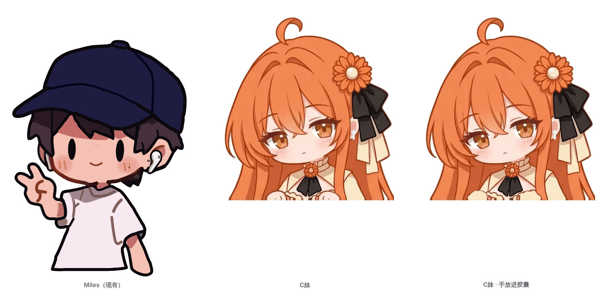

# 伙伴形象：C妹（设计稿）

状态：2026-11-03 第一版，等孙铭泽确认；还没接进产品。

- 原图：`source/c-mei-sheet.webp`（六格表情），孙铭泽提供，确认有授权、可以照原样用，头上的橙色花也照原样保留。
- 在线预览（Miles、Mia、C妹 三颗胶囊都是活的）：https://claude.ai/artifact/Lzyo5LFWRoF33m4SD3LaBF
- 本地打开 `preview.html` 是同一页，不用联网。



## 怎么做到一比一

不是照着重画，是把原图的像素按部件切开，放进和 Miles 同一套动作代码里：

- **头发、脸、衣服**：第 1 格（平时）整张，一层。
- **眼睛**拆成三层：
  - 眼白：眼珠底下补成白色，转眼时露出来；
  - 眼珠：裁在眼眶里，转眼时只移它；
  - 睫毛和上眼线：压在最上面。
- **嘴**：平时取第 1 格；说话的张嘴取第 2 格（张嘴那格）。
- **闭眼**：取第 4 格（闭眼笑那格）的眼睛，作为 rig 要求的闭眼部件放在画里（默认藏着）。
- **手**：两只扒在胶囊沿上的手，单独一层。

被挡住的地方补好了，动起来不会露出原画：
- 眨眼、转眼、说话时，底下补成皮肤和眼白；
- 两只手放进胶囊后，原来手的位置补成衬衫的米色和头发。

几层叠在一起时，每一层都用原图的像素、硬边，所以静止时和原图逐像素一样。放大 5 倍看眼睛，和原图看不出差别。

只多画了一样：右耳一只 AirPods。产品里「在听」时右耳的耳机会亮，三个形象一致。

## 和 Miles、Mia 的关系

- **一样的**
  - 坐标系和摆位：`CMEI_ART` 除了 `gazeUnit`，和 `MILES_ART` 逐项相同；胶囊在同一个位置，人一样大。
  - 动画用到的部件名都一样，动作代码是同一套（打了 `../buddy-girl-avatar/milesRig-iris-gaze.patch`，转眼只移眼珠）。
- **不一样的**
  - `gazeUnit` 是 7（Miles 和 Mia 是 15）：她的眼珠小，转眼幅度跟着收小，不会转出眼眶。
  - 原图是「扒着桌沿」的构图：两只手搭在胶囊上沿，所以「放手」是两只手松开、滑进胶囊，「打招呼」是两只手轻轻晃一下。
  - 手的转轴在两只手中间（447 860）；身子的转轴 388 1182 不变。
  - `body` 里套着 `head`：原图是一整张，头和身子分不开，所以侧头和呼吸带着整个上半身。
  - 画是位图（WebP，内嵌在 SVG 里），不是矢量：要一比一保留原画的线条和上色。体积约 69KB，和 Mia 差不多。
  - 胶囊上沿以下本来就看不到；整张画在胶囊上沿那里裁齐（`{id}-lip`），大图里也一样。

## 文件

| 文件 | 是什么 |
|-|-|
| `source/c-mei-sheet.webp` | 原图，六格表情 |
| `build.py` | 从原图切出各部件、补洞，生成 `cmeiArt.ts` 和 `cmei.svg`。改切法改这里 |
| `cmeiArt.ts` | 和 `milesArt.ts` 同格式：`CMEI_ART` 摆位常量 + `CMEI_SVG` 画。接入时放到 `apps/web/src/components/coagent/` |
| `cmei.svg` | 整张画，能直接打开看 |
| `check.cjs` | 自查：部件、id 前缀、转轴、默认藏着的变体、眼珠裁切、摆位常量 |
| `preview.html` | 预览页：Miles、Mia、C妹 三颗胶囊，动作一览，大图 |
| `renders/` | 整张画、产品尺寸 1×/3×、剪影、15 个动作、眼睛特写（转眼和眨眼） |

重新生成和自查（要 Pillow、numpy、scipy、scikit-image）：

```bash
python3 .scratch/buddy-cmei/build.py
```

```bash
node .scratch/buddy-cmei/check.cjs path/to/milesArt.ts
```

`milesArt.ts` 和 `milesRig.ts` 目前只在 `claude/handover-new-phase-review-c26739` 分支上；不给路径时只跳过摆位常量的比对。

## 验证（11/03）

- `check.cjs` 全部通过：部件都在、id 都带前缀、三个转轴、body 套着 head、默认藏着的变体、两颗眼珠都裁在眼眶里、摆位常量。
- `cmeiArt.ts` 用 `tsc --strict` 编译通过。
- 挂进打了补丁的 milesRig，15 个动作状态逐帧对照 Miles，见 `renders/motions.png`：
  - 在听、在说（张嘴）、眨眼（闭眼）；
  - 左右转头；
  - 举手回弹、松手中途、手放进胶囊；
  - 左右晃手；
  - 耳机亮、呼吸、升起；
  - 两种叠加的最坏情况。
- 眼睛放大看转眼和眨眼，见 `renders/glance.jpg`：只有眼珠在动，眨眼是整只眼睛合上。
- 实时动画跑过：
  - 9 秒里转了眼，两颗眼珠同步，切到在说后回正；
  - 出场、改名字、退场，控制台没有报错或警告；
  - 预览页本身也抓到一次转眼。
- 预览页在桌面（浅色、深色）和手机宽度下都没有报错，也没有横向溢出。

没做的：没在真实产品页面里跑过，因为 Miles 还在交接分支上。

## 已知的地方

- 眨眼：现在的 milesRig 眨眼是把睁着的眼睛整只压扁再弹开（150 毫秒），从来不显示闭眼部件，Miles 和 Mia 也一样。所以第 4 格的闭眼虽然在画里，眨眼时看不到；压到最扁的那一下，眼睛是一条带颜色的细线。要让她用第 4 格的闭眼眨眼，得改 rig（眨到一半换成闭眼部件）。
- 原图的分辨率：产品里一个像素对应原图约 0.5 个像素，3 倍屏下线条比原图略软，看 `renders/product-3x.png`。要更锐利，需要更大的原图。
- 原图六格里还有不高兴、哭这几种表情，这次没用上；产品现在只有平时、在听、在说三种状态。

## 接入时要做的（确认后）

- 给 `milesRig.ts` 打 `../buddy-girl-avatar/milesRig-iris-gaze.patch`。
- `milesRig` 改成按形象传入画和摆位常量（C妹 的 `gazeUnit` 不一样）。
- 没起名字时胶囊上的默认字给「C妹」。
- 契约 `BuddyForm` 加一个值，重新生成 web 的类型；在 `skin.ts` 的清单加一行。
- 要基于 Miles 所在的分支做，或等它合进 main。
