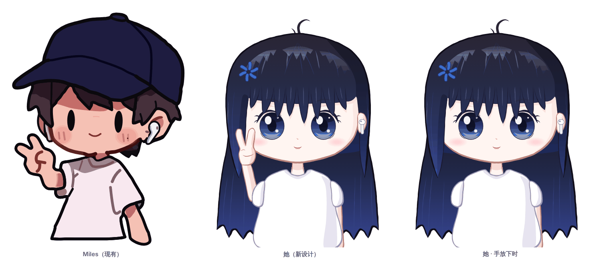

# 伙伴形象：女生款 Mia（设计稿）

状态：设计稿第六版，2026-11-03，等孙铭泽定稿；还没接进产品。

在线预览（两颗胶囊都是活的，可放大、切姿势、改名字）：https://claude.ai/artifact/Lzyo5LFWRoF33m4SD3LaBF
本地打开 `preview.html` 是同一页，不用联网。



## 现在的样子（11/03 第六版）

方向：Q 版比例，借孙铭泽给的参考图的气质——细软的线、克制的颜色、安静好看。

- 线条和上色：
  - 线条用笔刷画（`draw/ink.cjs`）：有粗细、两头收尖、带颜色；
  - 光从左上来，背光一侧线粗；
  - 皮肤、头发、衣服各有一层赛璐璐阴影。
- 头发：
  - 黑发，从发根渐变到发尾的深蓝紫；头顶一圈断开的光泽；
  - 空气刘海：八片叶形的发束一片压一片，朝两边散开，缝里透出额头和眉毛，额头上落着发束的影子；
  - 左边那缕盖住脸颊边，右边别在耳后，露出耳朵和 AirPods；
  - 背后的黑长直从两侧那缕后面起头，垂到腰下；
  - 头顶两根细呆毛。
- 脸：
  - 眼睛是低饱和的靛蓝，上眼线粗、外角两根睫毛，一道细细的双眼皮，一大一小两颗高光；
  - 安静的浅笑，腮红淡，不加斜线；鼻子只有一小笔。
- 配饰只留天枢 logo 发夹：直接读产品图标 `apps/web/src/app/icon.svg` 的六片花瓣，和图标一模一样。
- 衣服：白上衣，泡泡短袖。
- 两只 AirPods 只露右耳那只，在「在听」时发光。

## 怎么改到这一版的

孙铭泽 11/03 的几轮意见，前几版都在 git 历史里：

1. 对标 Miles 从零原创：同一世界的独立角色，同一朝向，用同一只手比耶。
2. 第一版：八字刘海、齐肩外翻、奶茶棕，Miles 的画法（提交 ebe05c3）。
   - 反馈：「太土了」。
3. 第二版：参考萨拉芬尼，粉紫蓝渐变高侧马尾、星星发饰、舞台感上衣。
4. 第三版：肤色再浅，眼睛重画。
5. 第四版：萨拉芬尼的配色，加上 Q 版 DeepSeek 的画风和发型，不要女仆装（提交 d93fd0e）。
6. 第五版：呆萌圆眼、头发不像海带、天枢 logo 发夹、头不显大；转眼改成只转眼珠（提交 f94a015）。
7. 第六版：
   - 反馈：「还是有些粗糙」，可以参考网上优秀的 Q 版设计，不用再受 Miles 的风格限制。
   - 又给了一张参考图（黑长直、白上衣、白色小兔发夹，不是 Q 版）：「整体感觉对，就是很好看的感觉」。
   - 在两个问题上选了：Q 版比例、借参考图的气质；发色用黑发渐变深蓝。
   - 于是整张重画，不再取 Miles 的部件；只保留和 rig 的约定。

## 转眼（为什么动了 rig）

- **原因**
  - milesRig 的「看一眼」和「在听」，是把整组 `eye-l`/`eye-r` 平移：最多横移 24、上移约 10、下移 12，约四分之一个眼宽。
  - Miles 是豆豆眼，整只眼睛就是眼珠，这样移就是在转眼。
  - 她是大眼睛，整组里有眼眶和睫毛，一起移就像五官在脸上滑。
- **改法**
  - 画：每只眼睛拆成钉住的眼眶（眼白、眶线、上眼线、睫毛）和眼珠 `iris-l`/`iris-r`。
    - 眼珠裁在眼眶里，平时正好填满眼眶，看不到眼白。
    - 两样都还在 `eye-l`/`eye-r` 里面，眨眼照样整只合上。
  - rig：`milesRig-iris-gaze.patch` 加 15 行、删 8 行。
    - 画里有 `iris-l` 和 `iris-r` 时，目光只移眼珠；没有就照旧整只眼睛移。
    - 转眼的方向、幅度、时长都没改。
- **效果**：往旁边看时眼珠靠向眼角，另一侧露出眼白；往上看眼珠藏进上眼线，往下看上面露一点眼白。见 `renders/glance.png`。
- **对 Miles 没影响**：同一页分别用打补丁前、后的 rig 挂 Miles，挂出来的 DOM 逐字相同（在听、在说，开动效和减少动效，共四种）。
- 不打补丁时她也能用，只是转眼还是整只眼睛移。

## 和 Miles 的关系

- **一样的**
  - 坐标系和缩放：`GIRL_ART` 和 `MILES_ART` 逐项相同，两人一样大，胶囊在同一个位置。
  - 三个转轴：头 444 806、身子 388 1182、手 268 912。
  - 动画用到的部件名都一样，动作是同一套代码；只有转眼要打上面那个补丁。
- **不一样的**
  - 画是全新画的，不再取 Miles 的脸、耳朵、手和身子。
  - 画风不再对标 Miles 的粗黑线贴纸风，这是 11/03 第六版按要求放开的。

## 层次（为什么这样摆）

- **背后的长发**（`data-part="hair-long"`）
  - 画在身体之前，所以在脖子、肩膀、手臂后面。
  - rig 只转 `head`，这一层不跟着头转。
  - 它从两侧那缕头发（跟着头转）的后面起头，侧头时接缝被那缕头发盖住。
- **右耳**：画在头发上面，就是「头发别在耳后」；AirPods 在耳朵上面。
- **比耶的手**
  - 放在最上层，用上衣和两只袖子的剪影遮住。
  - 所以在头发前面、衣服后面，放下时照样滑进衣服后面，和 Miles 一样。

## 文件

| 文件 | 是什么 |
|-|-|
| `girlArt.ts` | 和 `milesArt.ts` 同格式：`GIRL_ART` 摆位常量 + `GIRL_SVG` 画。接入时放到 `apps/web/src/components/coagent/` |
| `milesRig-iris-gaze.patch` | 给 `apps/web/src/components/coagent/milesRig.ts` 的补丁：画里有眼珠时转眼只移眼珠 |
| `girl.svg` | 整张画，能直接打开看，画布和 Miles 的一样 |
| `draw/draw.cjs` | 画法：各部分的锚点、颜色、阴影和高光。改画改这里 |
| `draw/ink.cjs` | 线稿笔刷：沿曲线按位置给宽度，线有粗细、两头收尖，背光一侧加粗 |
| `draw/lib.cjs` | 锚点转平滑曲线 |
| `draw/gen.cjs` | 由 `draw.cjs` 生成 `girl.svg` 和 `girlArt.ts` |
| `check.cjs` | 自查：能不能挂进 milesRig、眼珠是不是裁在眼眶里、摆位常量是否和 Miles 一致 |
| `preview.html` | 预览页。动作代码是打了补丁的 milesRig，只把画换成参数传进去 |
| `renders/` | 整张画、产品尺寸 1×/3×、剪影、动作一览、眼睛特写（转眼和眨眼） |

重新生成和自查：

```bash
node .scratch/buddy-girl-avatar/draw/gen.cjs
```

```bash
node .scratch/buddy-girl-avatar/check.cjs path/to/milesArt.ts
```

`milesArt.ts` 和 `milesRig.ts` 目前只在 `claude/handover-new-phase-review-c26739` 分支上。不给 `milesArt.ts` 的路径时，只跳过摆位常量的比对。

## 体积

- `girlArt.ts` 约 94KB，gzip 后约 33KB；Miles 的 `milesArt.ts` 约 33KB，gzip 后约 10KB。
- 多出来的主要是笔刷线条：每一笔是两条边的形状，不是一条描边。
- 已经把坐标取整、笔刷采样放宽到 18（对比过放大两倍的画，看不出差别）。
- 还要再小，可以继续放宽 `ink.cjs` 的采样间距，或简化只在大图里看得到的长发下摆和身子（约 25KB）。

## 验证（11/03，第六版）

- `check.cjs` 全部通过：
  - 动画要用的部件都在；
  - id 和 `url(#…)` 都是 `{id}-` 前缀；
  - 转轴、摆位常量和 Miles 一致；
  - 平时的嘴露着、张嘴和闭眼的变体默认藏着；
  - 两颗眼珠都在各自的眼睛里、套着眼眶的裁切。
- `girlArt.ts` 用 `tsc --strict` 编译通过。
- 生成的模块挂进打了补丁的 milesRig，15 个动作状态逐帧对照 Miles，见 `renders/motions.png`：
  - 在听、在说、眨眼；
  - 左右转头；
  - 举手回弹、放手中途、手放进胶囊；
  - 左右晃手；
  - 耳机亮、呼吸、升起；
  - 两种叠加的最坏情况。
- 眼睛放大 9 倍看转眼和眨眼，见 `renders/glance.png`。
- 实时动画跑过：
  - 在听 9 秒里发生了转眼，她的两颗眼珠始终同步；
  - 切到在说后眼珠回正；
  - 出场、退场，控制台没有报错或警告；
  - 预览页本身也抓到一次转眼。
- 预览页在桌面（浅色、深色）和手机宽度下都没有报错，也没有横向溢出。

没做的：没在真实产品页面里跑过，因为 Miles 还在交接分支上，这次没接入。

## 接入时要做的（定稿后）

- 给 `milesRig.ts` 打 `milesRig-iris-gaze.patch`。
- `milesRig` 现在直接 import `MILES_ART` / `MILES_SVG`，要改成按形象传入画。
- 没起名字时胶囊上的默认字（`MILES_NAME`）也要按形象给。
- 动作参数不用改。
- 契约 `BuddyForm` 加一个值，重新生成 web 的类型。
- 在 `skin.ts` 的清单加一行。
- 要基于 Miles 所在的分支做，或等它合进 main。

## 还没定的

- 她的名字，也就是没起名时胶囊上显示的字。预览里先用「Mia」占位。
- 选择页现在两列四格，加上她是 5 格，要不要换掉某一种。
- 她和 Miles 画风已经分开：Miles 要不要也往这个方向调。
