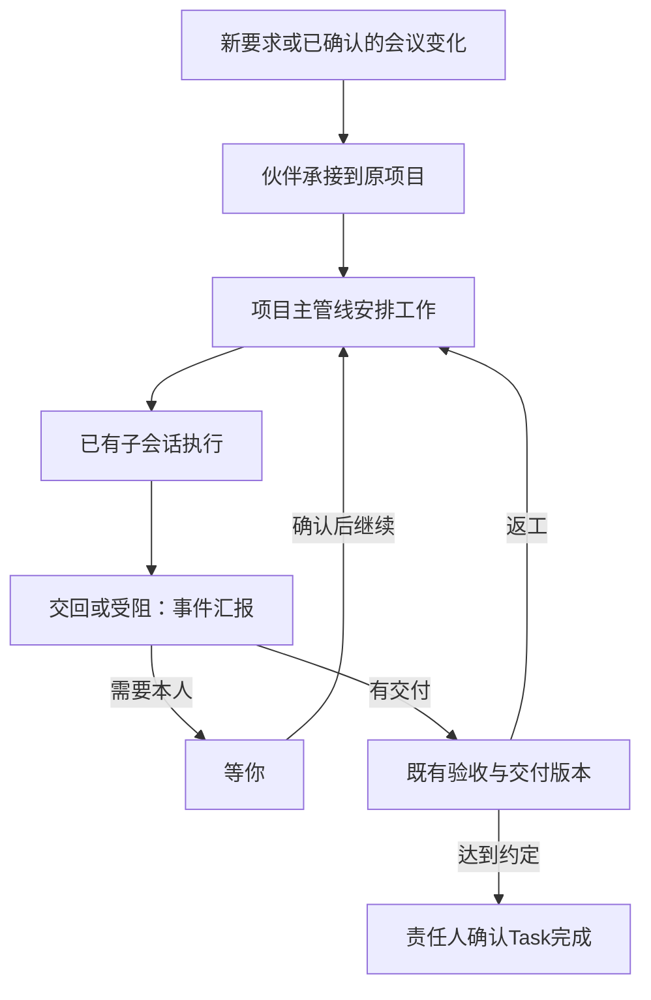

# 天枢伙伴的团队协作、持续承接与交付验收

Status: proposed
版本：0.2，含五项团队协作需求，待本人拍板
日期：2026-11-13（北京时间）
代码基线：`claude/new-home-integration` / `6da6068a`

## 1. 要实现的体验

本人可以持续把新要求、会议变化和材料交给伙伴。团队成员可以把文件或信息请求直接交给指定同事的伙伴。即时会和预约会结束后，有权限的参会人回到自己的伙伴主对话就能看到会议记录和与自己有关的下一步。已有项目继续推进，需本人决定的事项进入“等你”。

本次沿用现有伙伴、项目主管线、执行子会话、Nexus和Task验收。飞书妙记或天枢录音是会议内容的来源，系统保留出处。正常会后流程由系统取回记录并送达，免去成员复制和分发链接。

本文是待确认的产品设计，不表示所有能力已经实现。本人确认本文后，主会话再编写执行计划、分派子agent和集成验收。本轮不派发子agent、不修改产品代码。

## 2. 方案选择与范围

| 方案 | 取舍 | 本次选择 |
| --- | --- | --- |
| A：在当前伙伴和项目中补承接、事件汇报、会议去向、交付入口 | 延续当前对象和运行边界，改动可分阶段验收 | 推荐；本人已要求按推荐设计，本稿细化此方案 |
| B：新增独立的全局工作中心，重新组织现有入口 | 全局浏览更集中，但与当前首页、后台任务和Task面板形成重叠，迁移范围更大 | 本轮不采用 |

首版覆盖团队文件互传、临时与固定信息征集、即时会议、预约和预审、会后自动收件，以及现有项目的状态汇报、会后多去向递送和交付验收。

首版不扩展为新的云端执行平台，不替换现有Runtime，不引入另一套会后判断器或跨Task执行看板。Duet式晨间简报、外部账号定期巡查和无人值守的模型主动分析留作后续能力，不能把本次拍板解释成已开通这些自动化。

## 3. 四个角色如何分工

| 角色 | 职责 | 交接边界 |
| --- | --- | --- |
| 本人的天枢伙伴 | 接住同事发来的文件、信息和会议内容，帮本人向指定同事收集资料，识别工作去向，汇总有权查看的进展 | 每个人只通过自己的伙伴读写收发件。代表本人发回应、接受责任和开展工作按既有授权处理 |
| 项目主管线 | 维护本项目的当前工作，安排已批准的计划，派发、接收和验收执行子会话 | 接到新要求时先说明影响哪项现有工作；当前一轮不被无关新要求自动打断 |
| 执行子会话 | 完成明确范围的执行卡或探索工作，交回结果、证据和卡点 | 做完一轮、交回、技术验收通过、合回分别保留，不自行宣告本月Task完成 |
| Nexus | 沿用现有会后判断及本人确认链，形成有出处的会议变化和本人待处理项 | 伙伴承接和递送确认结果，不重复提取并再确认同一会议决定 |

项目是持续工作线；本月Task承接预期结果和验收约定；执行卡和探索子会话负责具体执行。现有执行卡仍是执行事项，不增加一个同义任务实体。

## 4. 页面布局

### 4.1 首页

沿用现有页面结构，从上到下：

| 区域 | 展示内容 | 可做的事 |
| --- | --- | --- |
| 等你 | 需要本人决定、补充、批准或确认的具体事项 | 就地处理，或进入原对象；同一事项保持一个待处理身份 |
| 会议 | 今天与未来7天的预约，以及更早但仍需跟进的会议，显示来源、时间和下一步 | 现在开会、预约、入会、看预审、打开自动收到的记录，缺记录时补材料或重试 |
| 本月 | 现有Mission与Task、截止及进展 | 进入原项目或Task，不新增跨Task执行看板 |
| 输入框 | 新要求或补充材料 | 继续现有“自动／伙伴／项目”的递送方式 |

会议行直接写下一步，如“明天09:30 · 预审待看”“已散会 · 等飞书生成妙记”“记录已到 · 2项与你有关”。确实没有记录来源时显示“缺记录”和可用的补救动作。

预审失败时显示失败和重试；返回编辑材料前的确认、预审失效及重新预审顺序沿用原页，首页不自动改材料。本人无权处理的操作只给查看入口，不凭主持人姓名推断权限。

飞书会议与天枢会议按现有稳定关联去重；不能只用标题和时间相似就把一场会隐藏。无会议时不占一大块空白，保留现有开会入口。

更远的天枢预约在同一区域折叠为“后续预约”，可以展开查看。飞书首版只展示当前接口已接入的7天窗口，并保留进入原日程的入口，不暗示已同步全部飞书日历。

### 4.2 伙伴主对话

标题下放默认收起的子会话摘要，展开后按项目分组，显示字母、标题、真实阶段和入口。现有侧栏与后台任务继续使用，不再增加另一套总览页面。

对话中的关键汇报只写：发生了什么、影响哪件工作、结果或证据入口、下一步需要谁。普通运行日志留在子会话。没有核对结果时，不能把“本轮结束”写成“这件事已完成”。

团队来件直接出现在自己的伙伴主对话，卡上给出发送人或会议来源、内容及可用动作。资料分享留在对话；需要本人回复、补材料或确认结论时，“等你”引用同一条记录。本人可在同一对话中追问刚收到的文件或会议，伙伴按本人权限读取所需内容。

### 4.3 项目主对话

同样的摘要只列本项目。新增要求进入本项目的工作队列，不覆盖旧工作；汇报和决定卡沿用已有时间线，能点回子会话和原始材料。

### 4.4 Task与交付

复用现有约定、对表、准备中的交付物和交付版本入口。交付显示版本、来源、对应完成标准、评审结果及待本人核对的部分。首版不照搬一个独立Make文件库。

## 5. 连续收到新要求时怎么处理

| 本人消息的含义 | 默认动作 |
| --- | --- |
| 补充现有要求 | 接到原工作，保留原要求、补充和来源；当前执行轮结束后递送，紧急情况按本人明确指令处理 |
| 新增一件事 | 追加到对应项目；没有确定去向时先给建议，不擅自另建重复项目 |
| 明确要求紧急插队 | 改排期并说明哪件工作后移；不把“紧急”解释为自动取消原工作 |
| 明确改变方向 | 保留旧方向及新的决定，通知受影响的执行方；未受影响的工作继续 |
| 明确停止／取消 | 沿用真实停止动作，确认实际回执，保留已完成成果和未处理事项 |
| 询问进度 | 读取当前数据和必要的结果，区分代码已交回、待验收、受阻、尚未开始 |

已批准范围内不为每次补充再问一轮许可。创建新工作、拆卡和执行仍遵守现有项目及目录规则；已有上下文能回答的，不让本人反复回答。

同一目标已有执行卡或子会话时优先接续。只有新增的独立目标或确有隔离需要时才新开子会话。

承接结果必须持久保存，能追溯到本人消息或已确认的会议变化，记录去向、先后和本次如何影响旧工作。不能只留在一轮模型上下文或临时计划气泡里。若现有项目动态和派活单不能表达这些信息，增加最小的承接／排序记录，引用已有对象；执行状态和完成状态仍从原对象读取。

### 5.1 团队成员直接投递和收集

发送人可以在自己的伙伴对话中拖入文件、粘贴文字或链接，写“发给小林的伙伴”，也可以从人员选择器选同事。收件地址是人员目录里的成员 ID。明确的收件人和内容一次发送即可；重名、未指定收件人或伙伴代拟了内容时，在原对话核对名单和正文后发送。

| 本人想做的事 | 对方伙伴收到什么 | 本人能看到什么 |
| --- | --- | --- |
| 分享文件或已收集的信息 | 原文件的指定版本，或本人选中发送的文字、出处和说明。可直接打开可读内容，有任务交代时可另接入获授权的现有工作 | 每位收件人的送达结果，失败项可单独重试 |
| 向同事收集信息 | 一条具体问题、需要的材料、来源和可选截止时间。对方可在自己的伙伴里答文字、附文件、标出缺项或要求澄清 | 回复回到发起人的同一条征集，按人列出待回复、需补充和已回复，能点回回复及附件 |

临时征集允许一句话发起，如“请产品和销售各给我两条客户反馈，周四前回”。复用现有按人收发的请求与回执，给临时请求补上接收人答复和附件。已有每周开销、每周进展继续使用原收集轮次、字段及确认动作。收件人的伙伴可应本人要求用获准材料起草，由本人发送或确认；发起人只收到本人交出的内容。

文件投递只授权指定收件人读取这次可分享的文件版本。原项目、子会话和同目录文件沿用各自权限。外部链接按收件人自己的来源权限打开；需要权限时给出申请或由发送人提供可分享版本的入口。原件权限变化后，重新打开引用时重新判定。直接上传的文件在本次投递范围内可读。

“已送达”以该成员能在云端取到这条来件为准，接收人离线也能在回来后看见。模型分析、本人查看、回复和执行各按实际发生记录。同一次发送重试复用请求与收件人身份，失败只重发该人。资料卡和“等你”共用原对象，已有工作继续保留其排期。

## 6. 主动汇报与自动执行的明确边界

现有契约`packages/contracts/src/projects.ts`明确记录：子会话报告不再触发主管线模型，主管线只在本人发话时回应。这是既有产品决定，不是本轮漏修的bug。

本稿推荐首版遵守这条决定，同时补上事件递送和注意力管理：

| 行为 | 首版默认 |
| --- | --- |
| 子会话状态变化 | 自动刷新界面，复用现有数据来源 |
| 普通停下一轮、一般进度、原始日志 | 记在原子会话和项目动态，不触发模型，不挤进主对话 |
| 已有验收结果、明确受阻、需要本人补充／决定 | 从已存事实生成简短事件卡，出现在原项目；与“等你”和伙伴提示关联，保留同一来源id |
| 项目主管线是否已读、是否已分析 | 分别反映真实回执；事件卡出现不能表示模型已经分析过 |
| 模型自动分析并重新派活 | 首版不开；本人点“继续推进”或给出新指令后，经当前执行通道接续 |
| 已经在执行的其他授权工作 | 不因一个局部等待而一并停掉，仍受现有依赖、预算与同目录执行约束 |

关键事件卡优先复用当前已有的报告摘要和验收结果，不为每条事件额外调用模型。重复同步、重连和刷新不重复生成同一条汇报或待处理项。

团队来件按收件人自动送达。预审、转写和会后整理沿用会议本身的处理流程；普通来件进入主对话时只更新事实和可用动作。代表收件人提交答复、接受任务或调动其本机执行，另以收件人的实际操作和授权为准。

后续若需要更接近Duet的主动分析，可以新增“允许本项目主管线主动整理关键结果”的项目级选项；必须作为对现有规则的明确修订，再确定模型调用、预算、授权和运行通道。本稿不把它暗含在首版里。

## 7. 会议怎样接回工作

### 7.1 现在开会与预约会议

| 入口 | 会前和会中 | 会后 |
| --- | --- | --- |
| 现在开会 | 在伙伴台选“现在开会”。现场会立即走已有录音入口；远程会选择同事，复用飞书会议，取得实际入会地址后，各受邀伙伴出现“加入会议”。已约的会可直接开原场次 | 就地结束，沿用同一会议 ID 收录音或妙记。即时开会无需等预审完成 |
| 预约会议 | 指定议题、时间、参会人，可附材料。受邀伙伴收到同一场预约，首页可进入会议。预审沿用已有流程，产出要讨论、要决定和待补材料，可从伙伴打开来源。改期、取消或改材料更新原场次，受影响的预审标记待更新 | 正文取回后自动送到有权接收的伙伴，会议页保留共同记录，伙伴提示本人相关的待确认项 |

远程会议只有取得可用入会地址才显示“加入”。飞书未连接或建会失败时，明确显示待授权或失败和重试入口。本机录音显示麦克风是否录上，录音中断可沿已有恢复流程处理。远端同事能实际入会是即时远程会议的验收条件。

### 7.2 会后自动收件

1. 天枢已关联的飞书会，接到妙记生成事件后用已授权身份取正文，事件漏收走现有轮询。本机录音完成后用录音与转写结果更新同一场会议。飞书链沿用现有逐字稿自动确认，本机候选沿用现有人工确认入口；结论仍走Nexus。正常路径中参会人粘贴链接次数为零。
2. 已确定场次后，主持人和具备内容读取权的内部参会人分别收到会议卡。参会身份优先取实际参会名单，无法取得时沿用经确认的天枢参会名单，逐人校验会议、内容来源和可见范围。受邀记录用于会前送达；取消、未出席和外部参会人按实际资格处理。具有全局查阅权限本身不构成自动订阅所有会议。
3. 直接在飞书开的会，已授权发现但未关联的妙记自动出现在所有者的伙伴。所有者可以先读自己有权读取的正文，再一键归入已有会议或整理为新会。只有时间或标题接近时，由所有者选定场次后再送达其他成员。现有轮询会按最近时间匹配，跨人发送前要核对双方原始会议标识或取所有者的选择，不能把按时间回填的会议号当作独立证据。
4. 卡片先显示“等妙记”“转写中”或“需要授权”。正文就绪后原卡更新，提供可打开的逐字稿或有出处的摘要、相关结论和本人下一步。内容缺失、未录音、转写失败、来源撤权各给对应原因和可用动作。保存一个网址只表示知道出处。
5. 同一会议在每个伙伴里只有一张卡。妙记事件、轮询和重连按同一来源去重。现场录音和飞书妙记同时存在时，两份来源列在同一卡上，已有人工确认的记录优先保留；修订版保留版本和出处。打开全文按当前收件人的权限取内容。把已确认事项交给项目另按第7.4节执行。

### 7.3 一场会可以有多个去向

会议本身不强制绑定唯一项目或唯一议题。保留现有议题和本体挂点，另外记录“这条变化接到哪项工作”：项目是主要去向，已有Task或子会话是可选的细化目标。

同一条变化可以送往多个目标；不能为每个目标复制创建一次会议，也不能自动把所有会后内容变成新的议题。

### 7.4 把会议变化交给项目

1. Nexus形成现有会后候选，继续本人确认／修改／拒绝链。
2. 伙伴展示变化的来源和建议去向，允许本人改去向、补充交代，或暂不递送。
3. 本人明确“继续推进”后，按目标分别递送。本人已明确授权的同一组去向可批量提交，无需为每一条再确认一次。
4. 目标主管线收到变化、来源、确认记录和必要的当前上下文，再接回现有工作。
5. 递送失败只重试该目标；已成功的目标不重复派活。显示“待递送／已递送／失败”，实际开工和后续完成仍读原工作状态。

如果本人在确认结论时同时明确了去向和“继续推进”，一次操作即可完成确认及递送；只确认会议结论时，不把它解释成已经授权所有后续执行。

每次递送至少携带：源变化／确认的稳定标识、飞书等出处及读取状态、已确认内容、目标项目和可选Task／子会话、本次交代、相关完成标准引用、授权人和确认版本。正文按需要读取，不能把全部会议原文无差别塞进每个子会话。递送和打开目标时都按当前对象权限校验；原来能访问不代表后续仍有权限。

### 7.5 branding案例

| 会议带来的变化 | 工作去向 | 接续方式 |
| --- | --- | --- |
| Logo设计方向改变 | 品牌建设项目／现有Logo子会话 | 带上已确认方向、原设计和飞书出处，更新同一条工作 |
| 词元云集官网有了内容 | 品牌建设项目／词元云集官网子会话 | 在既有骨架上继续细化内容，不另起一份丢掉原框架 |
| 睿积官网有了内容 | 品牌建设项目／睿积官网子会话 | 收到同一会议的相关变化，保留自己的页面范围与验收要求 |
| 有需要本人处理的事项 | 现有“等你”或本人负责的工作对象 | 先形成候选，按现有规则由本人决定；不把猜测当成已接受的责任 |

Logo等本人选择时，官网工作能否继续由实际依赖决定；不把整场会议或整个项目一并锁住。

## 8. 什么才算完成

| 节点 | 完成的含义 | 后续可能还缺什么 |
| --- | --- | --- |
| 会议结束 | 已结束录音或会议时段 | 记录、识别、记录确认 |
| 伙伴已收件 | 属于本人的文件、请求或会议来件已持久保存，离线返回可取 | 原文是否就绪、本人是否已看、回复或同意执行 |
| 记录确认 | 这份逐字稿可以用于后续整理 | 结论的逐项判断与确认 |
| 会后事项确认 | 本人处理了相应候选 | 是否继续推进、去向及执行 |
| 旧会议链定版 | 沿用既有全处理或48小时冻结规则，只纳入已确认项 | Nexus处理、本体同步和具体工作，不因此自动完成 |
| 上下文递送 | 目标已持久接收这条变化 | 开工、执行和验收 |
| 子会话做完一轮 | 本轮停下或产生结果 | 交回、返工或验收 |
| 执行卡验收完成 | 按现有规则通过验收，并完成需要的合回 | 本月Task是否达到全部约定 |
| 本月Task完成 | 责任人本人按现有完成标准及权限确认 | 不由会议定版或一次模型回答代替 |

`waiting/null`不能显示已完成；`waiting/merge`显示等合回；`needs_person`显示需要本人补充；验收未过与程序异常分开表达。状态取现有事实，不能为更好看的汇报编造进度。

## 9. 实现时必须保留的边界

- **权限跟着对象走。** 伙伴只汇总本人有权读取的项目和结果。团队成员及认可人的可见、可改权限沿用现有Task约定；不能因为共享一场会议就开放所有相关项目。
- **会后判断只有现有一条链。** 核对`MEETING_WORLD_WRITES_OFF`和Nexus接线，避免旧会议动作和新递送重复通知、重复确认或重复写入。
- **云端只收本机上报。** 按ADR-0036，开工、插话、退回经已授权网页与本机通道。离线时保留待处理状态，不新增服务器直接遥控本机的通道。
- **交付物沿用版本。** 按ADR-0034，执行卡通过验收后进入现有交付准备区，按既有规则出版本，不另造文件库。
- **约定只有一个来源。** 按ADR-0033，保留11月天枢补充／本体优先的读取规则和交付版本约定快照，不按字段把两边拼成新标准。
- **不新增跨Task执行看板。** 使用现有项目摘要与worker列表，不违反ADR-0034。
- **API拥有业务规则。** Web呈现状态及动作；新投影先改contracts再生成客户端；不手改生成文件。

首版优先沿用会议、请求、接收人和收集轮次。若现有对象不足以表示伙伴送达、文件版本授权、临时征集答复或会议工作去向，只补对应关联和回执。业务事实由原对象维护，伙伴主对话按成员权限呈现。共享契约由主会话在执行计划中定版。

## 10. 分阶段实施与子agent分工

时间按验收关口滚动安排，不把估算当成已承诺的上线日期。本人拍板后才派发，主会话负责合约、集成和验收。

| 阶段 | 工作 | 退出条件 |
| --- | --- | --- |
| 0：接住已有成果 | 保留`d3673300`会议修复和`6da6068a`状态摘要；核对运行环境、设备与数据；列出可运行的真实验收项 | 不重做已有代码；权限和缺失检查明确，未通过的保持待验收 |
| 1：会后自动到伙伴 | 首页和预审入口、伙伴关键事件提示、按人收会议记录。优先打通一场已有会议到两位伙伴 | 两位有权成员各自打开同一场会的可读记录，全程零粘贴。待授权、待生成和归属不明有明确去处 |
| 2：文件与信息 | 先交付成员间直接传文件，再接临时征集与既有固定征集 | 甲发给乙的版本可以打开；乙在自己的伙伴答复，回答及附件回到甲的原请求 |
| 3：即时与预约全程 | 即时远程邀请和入会、现场录音、预约改期与预审，接上阶段1的会后收件 | 分别从“现在开会”和“预约会议”跑通一次，从收邀请、开会到自动收到内容能核对同一场次 |
| 4：会后交项目与整体验收 | 接回原先已排期的一会多去向、逐目标回执和失败重试，再做双账号、数据库、桌面与手机验收 | branding案例能接回三个已有工作，确认、递送、开工及交付有各自证据。运行版与未验项可核对 |

拟定分工：

| 子agent | 责任范围 | 依赖与限制 |
| --- | --- | --- |
| A：首页与会议 | 负责阶段1的会议归属、预审投影、会后收件来源，阶段3接上即时与预约入口 | 与B按会议事实和主对话展示分开。以实际取得的入会地址和正文验收 |
| B：伙伴与事件 | 阶段1负责主对话的收件展示、权限读取、关键事件和去重，复用既有状态摘要 | 一条事实能从首页或对话打开原对象，收件不触发额外派活 |
| D：团队文件与征集 | 阶段2复用请求收发、附件和原征集轮次，完成指定收件人读取及回复 | 在收件契约定版后接入，先验文件，后验回收。交付给B的已有展示入口 |
| C：会议工作衔接 | 阶段4负责确认结论到多个工作去向的递送、回执和重试 | 复用已定版的会议和收件契约，保留原项目与子会话 |
| 独立验收agent | 实现交回后验证五条团队需求和原有持续承接场景 | 用真实的两位成员走通收发，另用无权身份验证隔离，记录真实运行环境结果 |

主会话不外包以下责任：排期和新增需求承接、共享契约与文件归属、检查实际diff、处理集成冲突、核验测试输出、决定是否提交本人验收。优先使用隔离worktree；同一共享文件不同时交给两名实现者。

## 11. 验收场景

| 场景 | 必须观察到的结果 |
| --- | --- |
| 一个子会话在跑时本人追加新要求 | 原工作没有消失，新要求有去向和先后；没有无故停掉原执行 |
| 一个执行步骤等本人 | 只阻塞实际依赖它的工作，其他已授权工作继续 |
| 子会话正常结束一轮 | 网页和读取接口都表达本轮结束，不冒充整件工作完成 |
| 技术验收通过但未合回 | 显示等合回，不显示本月Task已完成 |
| 重复同步、重连或重复确认 | 不重复通知、不重复生成工作、不重复递送成功目标 |
| 同一会议影响Logo和两个官网 | 能分别送到三个已有工作去向，保留同一会议来源 |
| 只有飞书链接、正文读取失败 | 仍可打开来源，但不会显示已通读或基于未读正文形成结论 |
| 只确认逐字稿或会议结论 | 不直接把所有后续工作标开工或完成 |
| 设备离线、额度不足或目录未授权 | 显示真实等待／失败及恢复条件，不虚报后台仍在执行 |
| 查看其他人的项目或交付 | 按现有对象权限拦截，伙伴汇总不越权 |
| 深色、浅色、桌面及手机 | 会议摘要、下拉、决定卡和主要入口可读可操作；焦点与Escape行为正确 |
| 验收环境不可访问 | 明确记为未验收，不能仅凭静态检查称正式运行版已完成 |

以下五项使用至少两个独立成员账号。成员甲和乙互为收发两端，实际验证收件人在另一台设备或重新登录后还能完成操作。

| 新增需求 | 通过条件 |
| --- | --- |
| 1．会后免贴链接 | 已关联且有可读妙记的会议，甲乙各收一张可打开正文的会议卡。模拟事件漏收后由轮询补到；事件重放、刷新和补到都只更新一次来件。两场相近且归属不明时只由所有者选场次，其他人收到的内容与来源相符 |
| 2．直接给同事伙伴传文件 | 甲拖入文件并发给乙；乙离线后再登录可打开相同版本和内容，带回的说明齐全。丙未被指定，不能读取该分享或凭此访问原项目。重试不会使乙收到两份 |
| 3．收集与转交信息 | 甲向乙、丙发同一临时问题，乙在伙伴回文字和附件，丙尚未交。甲在原请求看清两人的进度，再收到丙的回复后可查两条出处。只转交一条已有信息时，收件人能看到指定内容；既有固定征集仍沿用逐人确认 |
| 4．开始即时会议 | 现场会能直接录并回到该会议的记录；远程会中乙能从自己的伙伴加入甲刚开始的同一会议。授权失败、没录上和仍在生成分别给出真实状态 |
| 5．预约、预审、会后承接 | 甲预约并选乙，乙在伙伴能看到时间与预审；改期和更换材料更新原预约。会后两人看到各自有权读取的内容，确认结论并明确继续后才产生工作递送。另测取消的预约不会产生会后任务 |

## 12. 已有基础、待完成和本稿默认决定

已有代码：会议确认／下拉／局部深色修复`d3673300`；主对话状态摘要及`read_project`快照`6da6068a`。这些提交的历史针对性检查已通过，但3700尚未切换，真实浏览器和数据库验收仍缺。

已核对的团队协作基础与增量如下。这里描述集成分支源码，运行版仍待联调。

| 已有基础 | 需补齐的产品行为 |
| --- | --- |
| 飞书妙记生成事件、轮询、逐字稿读取；未关联妙记归所有者待整理 | 将结果送进有权成员的伙伴主对话。对“按最近时间命中”的结果保留关联依据，跨人投递前完成校验 |
| 伙伴台现场录音，预约可指定参会人并同步飞书日程、发邀请、保存入会地址；已有会前预审 | 即时入口选同事并加入远程会议，首页显示预审，改期与会后内容在原会议卡更新。旧首页会议列表缺预审字段 |
| 按成员的传话请求、收件／已发列表和问答；子会话附件有既定读取权限 | 伙伴里选人投递文字与指定文件版本，收件人有范围明确的读取权，能在自己的伙伴继续使用 |
| 每周开销与每周进展两类征集有轮次、接收人、回复字段和确认 | 补任意一次性问题、文字或附件回传，使发起人与接收人都能从各自伙伴处理 |

原排期里的伙伴关键事件、已确认会议事项交多项目或子会话、运行页验收继续保留。

主会话在本稿中提出的默认决定，供本人拍板时重点核对：

1. 首页按“等你 → 会议 → 本月”排列，近期会议默认未来7天，未处理的会后事项继续保留。
2. 一场会允许多个工作去向，优先接续已有Task／子会话；保持飞书分享和Nexus确认链。
3. 首版主动的是事件汇报与提示，模型自动分析并派活保持关闭；本人明确继续推进后走当前执行通道。
4. 沿用现有交付版本和验收权限，不新增一套Task、文件库或跨Task看板。
5. 已关联会议默认送主持人和有内容权限的内部参会人；仅有可疑归属的妙记先到所有者。团队投递默认只向指名成员分享指定材料，征集回复由接收人提交。
6. 按“会后收件、团队文件、信息征集、即时与预约全程、会后交项目”顺序验收。本人确认本稿后启动分工。

## 13. 设计自查与来源

因本人要求拍板后才调动子agent，本稿由主会话自行完成建造可行性检查，未提前派评审agent。

自查结论：保留ADR-0033／0034／0036；把项目契约中的“不自动唤醒模型”作为首版约束；未假定新首页已有预审字段；明确一轮完成、验收、合回和本人Task完成；把目录授权和浏览器访问限制作为真实验收阻塞，不把子agent当作权限解决方案。

依据：[主队列](../codex-main-session/map.md)、[Duet与工具调研](../codex-main-session/research-duet-tools-2026-11-13.md)、`packages/contracts/src/projects.ts`、`packages/contracts/src/meetings.ts`、`apps/api/src/projectLocalTurns.ts`、`apps/web/src/components/home/HomeView.tsx`、`apps/web/src/components/member/MemberMeetingSchedule.tsx`及ADR-0033／0034／0036。

本次增补另外核对了飞书日程、妙记和待整理、会议卡可见范围、伙伴台即时录音、请求收发、附件读取与两类固定征集。[自动取妙记](../../apps/api/src/meetingMinutes.ts) · [未关联妙记](../../apps/api/src/feishuMinuteInbox.ts) · [会议卡](../../apps/api/src/meetingCard.ts) · [预约同步](../../apps/api/src/meetingFeishuEvent.ts) · [伙伴台开会](../../apps/web/src/components/home/MeetingControl.tsx) · [传话](../../packages/contracts/src/requests.ts) · [征集](../../packages/contracts/src/collections.ts) · [附件读取](../../apps/api/src/sessionAttachments.ts)

飞书官方 SDK 列有妙记生成事件与获取逐字稿的接口，部署时仍需用实际租户授权验证收取和访问范围。[飞书开放平台 SDK](https://pkg.go.dev/github.com/larksuite/oapi-sdk-go/v3/service/minutes/v1)
