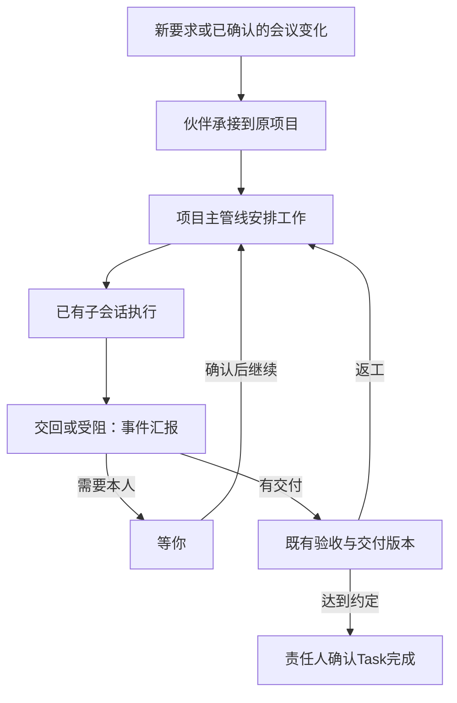

# 天枢伙伴：持续承接、会议衔接与交付验收

Status: proposed
版本：0.1，待本人拍板
日期：2026-11-13（北京时间）
代码基线：`claude/new-home-integration` / `6da6068a`

## 1. 要实现的体验

本人可以持续把新要求、会议变化和材料交给伙伴。伙伴把它们接回正在推进的项目，保留未完成工作，呈现谁在做、卡在哪里、交付了什么，只把需要本人处理的节点带回来。

本次采用在现有天枢上逐步补齐的方案。保持伙伴、项目主管线、执行子会话、Nexus和既有Task验收的分工；沿用飞书分享链接与本机执行通道。

本文是待确认的产品设计，不表示所有能力已经实现。本人确认本文后，主会话再编写执行计划、分派子agent和集成验收。本轮不派发子agent、不修改产品代码。

## 2. 方案选择与范围

| 方案 | 取舍 | 本次选择 |
| --- | --- | --- |
| A：在当前伙伴和项目中补承接、事件汇报、会议去向、交付入口 | 延续当前对象和运行边界，改动可分阶段验收 | 推荐；本人已要求按推荐设计，本稿细化此方案 |
| B：新增独立的全局工作中心，重新组织现有入口 | 全局浏览更集中，但与当前首页、后台任务和Task面板形成重叠，迁移范围更大 | 本轮不采用 |

首版包含：首页会议及预审、准确的子会话状态、关键事件汇报、会议到多个工作去向的确认与递送、既有交付物和完成标准的衔接。

首版不扩展为新的云端执行平台，不替换现有Runtime，不引入另一套会后判断器或跨Task执行看板。Duet式晨间简报、外部账号定期巡查和无人值守的模型主动分析留作后续能力，不能把本次拍板解释成已开通这些自动化。

## 3. 四个角色如何分工

| 角色 | 职责 | 交接边界 |
| --- | --- | --- |
| 本人的天枢伙伴 | 接住新要求、识别工作去向、看本人有权查看的整体进展、递送变化、带回需要本人处理的事 | 对已明确授权的范围继续准备和递送；新增范围、关键判断和对外动作按既有规则处理 |
| 项目主管线 | 维护本项目的当前工作，安排已批准的计划，派发、接收和验收执行子会话 | 接到新要求时先说明影响哪项现有工作；当前一轮不被无关新要求自动打断 |
| 执行子会话 | 完成明确范围的执行卡或探索工作，交回结果、证据和卡点 | 做完一轮、交回、技术验收通过、合回分别保留，不自行宣告本月Task完成 |
| Nexus | 沿用现有会后判断及本人确认链，形成有出处的会议变化和本人待处理项 | 伙伴承接和递送确认结果，不重复提取并再确认同一会议决定 |

项目是持续工作线；本月Task承接预期结果和验收约定；执行卡和探索子会话负责具体执行。现有执行卡仍是执行事项，不增加一个同义任务实体。

## 4. 页面布局

### 4.1 首页

沿用现有页面结构，从上到下：

| 区域 | 展示内容 | 可做的事 |
| --- | --- | --- |
| 等你 | 需要本人决定、补充、批准或确认的具体事项 | 就地处理，或进入原对象；同一事项保持一个待处理身份 |
| 会议 | 今天与未来7天的预约，以及更早但仍需跟进的会议；显示来源、时间和下一步 | 查看预审、补材料、查看记录候选、上传记录或重试失败环节 |
| 本月 | 现有Mission与Task、截止及进展 | 进入原项目或Task，不新增跨Task执行看板 |
| 输入框 | 新要求或补充材料 | 继续现有“自动／伙伴／项目”的递送方式 |

会议行用一句具体状态说明下一步，例如“明天09:30 · 预审准备中”“今天结束 · 待交记录”“记录已确认 · 2项待处理”。不能只用“会议完成”掩盖后续尚未处理的工作。

预审失败时显示失败和重试；返回编辑材料前的确认、预审失效及重新预审顺序沿用原页，首页不自动改材料。本人无权处理的操作只给查看入口，不凭主持人姓名推断权限。

飞书会议与天枢会议按现有稳定关联去重；不能只用标题和时间相似就把一场会隐藏。无会议时不占一大块空白，保留现有开会入口。

更远的天枢预约在同一区域折叠为“后续预约”，可以展开查看。飞书首版只展示当前接口已接入的7天窗口，并保留进入原日程的入口，不暗示已同步全部飞书日历。

### 4.2 伙伴主对话

标题下放默认收起的子会话摘要，展开后按项目分组，显示字母、标题、真实阶段和入口。现有侧栏与后台任务继续使用，不再增加另一套总览页面。

对话中的关键汇报只写：发生了什么、影响哪件工作、结果或证据入口、下一步需要谁。普通运行日志留在子会话。没有核对结果时，不能把“本轮结束”写成“这件事已完成”。

### 4.3 项目主对话

同样的摘要只列本项目。新增要求进入本项目的工作队列，不覆盖旧工作；汇报和决定卡沿用已有时间线，能点回子会话和原始材料。

### 4.4 Task与交付

复用现有约定、对表、准备中的交付物和交付版本入口。交付显示版本、来源、对应完成标准、评审结果及待本人核对的部分。首版不照搬一个独立Make文件库。

## 5. 连续收到新要求时怎么处理

| 本人消息的含义 | 默认动作 |
| --- | --- |
| 补充现有要求 | 接到原工作，保留原要求、补充和来源；当前执行轮结束后递送，紧急情况按本人明确指令处理 |
| 新增一件事 | 追加到对应项目；没有确定去向时先给建议，不擅自另建重复项目 |
| 明确要求紧急插队 | 改排期并说明哪件工作后移；不把“紧急”解释为自动取消原工作 |
| 明确改变方向 | 保留旧方向及新的决定，通知受影响的执行方；未受影响的工作继续 |
| 明确停止／取消 | 沿用真实停止动作，确认实际回执，保留已完成成果和未处理事项 |
| 询问进度 | 读取当前数据和必要的结果，区分代码已交回、待验收、受阻、尚未开始 |

已批准范围内不为每次补充再问一轮许可。创建新工作、拆卡和执行仍遵守现有项目及目录规则；已有上下文能回答的，不让本人反复回答。

同一目标已有执行卡或子会话时优先接续。只有新增的独立目标或确有隔离需要时才新开子会话。

承接结果必须持久保存，能追溯到本人消息或已确认的会议变化，记录去向、先后和本次如何影响旧工作。不能只留在一轮模型上下文或临时计划气泡里。若现有项目动态和派活单不能表达这些信息，增加最小的承接／排序记录，引用已有对象；执行状态和完成状态仍从原对象读取。

## 6. 主动汇报与自动执行的明确边界

现有契约`packages/contracts/src/projects.ts`明确记录：子会话报告不再触发主管线模型，主管线只在本人发话时回应。这是既有产品决定，不是本轮漏修的bug。

本稿推荐首版遵守这条决定，同时补上事件递送和注意力管理：

| 行为 | 首版默认 |
| --- | --- |
| 子会话状态变化 | 自动刷新界面，复用现有数据来源 |
| 普通停下一轮、一般进度、原始日志 | 记在原子会话和项目动态，不触发模型，不挤进主对话 |
| 已有验收结果、明确受阻、需要本人补充／决定 | 从已存事实生成简短事件卡，出现在原项目；与“等你”和伙伴提示关联，保留同一来源id |
| 项目主管线是否已读、是否已分析 | 分别反映真实回执；事件卡出现不能表示模型已经分析过 |
| 模型自动分析并重新派活 | 首版不开；本人点“继续推进”或给出新指令后，经当前执行通道接续 |
| 已经在执行的其他授权工作 | 不因一个局部等待而一并停掉，仍受现有依赖、预算与同目录执行约束 |

关键事件卡优先复用当前已有的报告摘要和验收结果，不为每条事件额外调用模型。重复同步、重连和刷新不重复生成同一条汇报或待处理项。

后续若需要更接近Duet的主动分析，可以新增“允许本项目主管线主动整理关键结果”的项目级选项；必须作为对现有规则的明确修订，再确定模型调用、预算、授权和运行通道。本稿不把它暗含在首版里。

## 7. 会议怎样接回工作

### 7.1 两条入口，共用后续规则

正式多人会和材料分享优先沿用飞书；天枢快速录音承接临时会。两者都保留来源，进入现有记录与会后处理链。

材料读取用真实状态表达：仅保存链接、读取中、已读取、读取失败。读取成功要有可核对的内容或摘要及读取时间；不支持或未获授权的链接保留入口并说明原因。

### 7.2 一场会可以有多个去向

会议本身不强制绑定唯一项目或唯一议题。保留现有议题和本体挂点，另外记录“这条变化接到哪项工作”：项目是主要去向，已有Task或子会话是可选的细化目标。

同一条变化可以送往多个目标；不能为每个目标复制创建一次会议，也不能自动把所有会后内容变成新的议题。

### 7.3 本人确认和继续推进

1. Nexus形成现有会后候选，继续本人确认／修改／拒绝链。
2. 伙伴展示变化的来源和建议去向，允许本人改去向、补充交代，或暂不递送。
3. 本人明确“继续推进”后，按目标分别递送。本人已明确授权的同一组去向可批量提交，无需为每一条再确认一次。
4. 目标主管线收到变化、来源、确认记录和必要的当前上下文，再接回现有工作。
5. 递送失败只重试该目标；已成功的目标不重复派活。显示“待递送／已递送／失败”，实际开工和后续完成仍读原工作状态。

如果本人在确认结论时同时明确了去向和“继续推进”，一次操作即可完成确认及递送；只确认会议结论时，不把它解释成已经授权所有后续执行。

每次递送至少携带：源变化／确认的稳定标识、飞书等出处及读取状态、已确认内容、目标项目和可选Task／子会话、本次交代、相关完成标准引用、授权人和确认版本。正文按需要读取，不能把全部会议原文无差别塞进每个子会话。递送和打开目标时都按当前对象权限校验；原来能访问不代表后续仍有权限。

### 7.4 branding案例

| 会议带来的变化 | 工作去向 | 接续方式 |
| --- | --- | --- |
| Logo设计方向改变 | 品牌建设项目／现有Logo子会话 | 带上已确认方向、原设计和飞书出处，更新同一条工作 |
| 词元云集官网有了内容 | 品牌建设项目／词元云集官网子会话 | 在既有骨架上继续细化内容，不另起一份丢掉原框架 |
| 睿积官网有了内容 | 品牌建设项目／睿积官网子会话 | 收到同一会议的相关变化，保留自己的页面范围与验收要求 |
| 有需要本人处理的事项 | 现有“等你”或本人负责的工作对象 | 先形成候选，按现有规则由本人决定；不把猜测当成已接受的责任 |

Logo等本人选择时，官网工作能否继续由实际依赖决定；不把整场会议或整个项目一并锁住。

## 8. 什么才算完成

| 节点 | 完成的含义 | 后续可能还缺什么 |
| --- | --- | --- |
| 会议结束 | 已结束录音或会议时段 | 记录、识别、记录确认 |
| 记录确认 | 这份逐字稿可以用于后续整理 | 结论的逐项判断与确认 |
| 会后事项确认 | 本人处理了相应候选 | 是否继续推进、去向及执行 |
| 旧会议链定版 | 沿用既有全处理或48小时冻结规则，只纳入已确认项 | Nexus处理、本体同步和具体工作，不因此自动完成 |
| 上下文递送 | 目标已持久接收这条变化 | 开工、执行和验收 |
| 子会话做完一轮 | 本轮停下或产生结果 | 交回、返工或验收 |
| 执行卡验收完成 | 按现有规则通过验收，并完成需要的合回 | 本月Task是否达到全部约定 |
| 本月Task完成 | 责任人本人按现有完成标准及权限确认 | 不由会议定版或一次模型回答代替 |

`waiting/null`不能显示已完成；`waiting/merge`显示等合回；`needs_person`显示需要本人补充；验收未过与程序异常分开表达。状态取现有事实，不能为更好看的汇报编造进度。

## 9. 实现时必须保留的边界

- **权限跟着对象走。** 伙伴只汇总本人有权读取的项目和结果。团队成员及认可人的可见、可改权限沿用现有Task约定；不能因为共享一场会议就开放所有相关项目。
- **会后判断只有现有一条链。** 核对`MEETING_WORLD_WRITES_OFF`和Nexus接线，避免旧会议动作和新递送重复通知、重复确认或重复写入。
- **云端只收本机上报。** 按ADR-0036，开工、插话、退回经已授权网页与本机通道。离线时保留待处理状态，不新增服务器直接遥控本机的通道。
- **交付物沿用版本。** 按ADR-0034，执行卡通过验收后进入现有交付准备区，按既有规则出版本，不另造文件库。
- **约定只有一个来源。** 按ADR-0033，保留11月天枢补充／本体优先的读取规则和交付版本约定快照，不按字段把两边拼成新标准。
- **不新增跨Task执行看板。** 使用现有项目摘要与worker列表，不违反ADR-0034。
- **API拥有业务规则。** Web呈现状态及动作；新投影先改contracts再生成客户端；不手改生成文件。

首版可增加会议与工作去向的关联、递送及回执等最小记录。具体字段命名、迁移和接口拆分由拍板后的执行计划确定，但以上语义、权限和去重结果不得改变。

## 10. 分阶段实施与子agent分工

时间按验收关口滚动安排，不把估算当成已承诺的上线日期。本人拍板后才派发，主会话负责合约、集成和验收。

| 阶段 | 工作 | 退出条件 |
| --- | --- | --- |
| 0：接住已有成果 | 保留`d3673300`会议修复和`6da6068a`状态摘要；核对运行环境、设备与数据；列出可运行的真实验收项 | 不重做已有代码；权限和缺失检查明确，未通过的保持待验收 |
| 1：首页与关键事件 | 首页会议／预审；项目及伙伴的关键事件提示；模型与网页读取一致 | 能从首页进入具体会议和工作，同一事件只出现一次处理身份，不自动唤醒模型 |
| 2：会后工作递送 | 多去向确认、已有工作接续、逐目标递送回执与失败重试 | branding案例完整走通，确认、递送、开工、交付各有真实证据 |
| 3：整体验收 | 完成状态、权限、重复事件、设备离线、深浅色、桌面／手机验证 | 用户关心的路径全部有结果；真实运行页版本明确，可交本人验收 |

拟定分工：

| 子agent | 责任范围 | 依赖与限制 |
| --- | --- | --- |
| A：首页会议 | 会议摘要投影、首页会议区、预审与会后入口 | 独立界面模块；共享contracts的变更先交主会话定版 |
| B：状态与事件 | 复核现有状态摘要、关键事件去重及原项目／伙伴提示 | 不扩大到自动模型唤醒；不把已做的摘要另写一套 |
| C：会议工作衔接 | 在阶段1合约稳定后实现多去向、上下文递送和回执 | 依赖事件／递送约定，顺序启动，避免与B改同一共享模块 |
| 独立验收agent | 按原需求和设计稿检查结果及关键路径 | 实现交回后启动；子agent说完成不直接等于通过 |

主会话不外包以下责任：排期和新增需求承接、共享契约与文件归属、检查实际diff、处理集成冲突、核验测试输出、决定是否提交本人验收。优先使用隔离worktree；同一共享文件不同时交给两名实现者。

## 11. 验收场景

| 场景 | 必须观察到的结果 |
| --- | --- |
| 一个子会话在跑时本人追加新要求 | 原工作没有消失，新要求有去向和先后；没有无故停掉原执行 |
| 一个执行步骤等本人 | 只阻塞实际依赖它的工作，其他已授权工作继续 |
| 子会话正常结束一轮 | 网页和读取接口都表达本轮结束，不冒充整件工作完成 |
| 技术验收通过但未合回 | 显示等合回，不显示本月Task已完成 |
| 重复同步、重连或重复确认 | 不重复通知、不重复生成工作、不重复递送成功目标 |
| 同一会议影响Logo和两个官网 | 能分别送到三个已有工作去向，保留同一会议来源 |
| 只有飞书链接、正文读取失败 | 仍可打开来源，但不会显示已通读或基于未读正文形成结论 |
| 只确认逐字稿或会议结论 | 不直接把所有后续工作标开工或完成 |
| 设备离线、额度不足或目录未授权 | 显示真实等待／失败及恢复条件，不虚报后台仍在执行 |
| 查看其他人的项目或交付 | 按现有对象权限拦截，伙伴汇总不越权 |
| 深色、浅色、桌面及手机 | 会议摘要、下拉、决定卡和主要入口可读可操作；焦点与Escape行为正确 |
| 验收环境不可访问 | 明确记为未验收，不能仅凭静态检查称正式运行版已完成 |

## 12. 已有基础、待完成和本稿默认决定

已有代码：会议确认／下拉／局部深色修复`d3673300`；主对话状态摘要及`read_project`快照`6da6068a`。这些提交的历史针对性检查已通过，但3700尚未切换，真实浏览器和数据库验收仍缺。

待开发：完整首页会议区、预审摘要、伙伴关键事件提示、会后多去向关联和递送。源代码显示旧`MemberMeetingSchedule`没有预审字段，不能直接贴旧组件就认为完整实现。

主会话在本稿中提出的默认决定，供本人拍板时重点核对：

1. 首页按“等你 → 会议 → 本月”排列，近期会议默认未来7天，未处理的会后事项继续保留。
2. 一场会允许多个工作去向，优先接续已有Task／子会话；保持飞书分享和Nexus确认链。
3. 首版主动的是事件汇报与提示，模型自动分析并派活保持关闭；本人明确继续推进后走当前执行通道。
4. 沿用现有交付版本和验收权限，不新增一套Task、文件库或跨Task看板。
5. 本人确认本稿后，先派首页与事件两条独立分工，再做依赖它们的会后递送，最后独立验收。

## 13. 设计自查与来源

因本人要求拍板后才调动子agent，本稿由主会话自行完成建造可行性检查，未提前派评审agent。

自查结论：保留ADR-0033／0034／0036；把项目契约中的“不自动唤醒模型”作为首版约束；未假定新首页已有预审字段；明确一轮完成、验收、合回和本人Task完成；把目录授权和浏览器访问限制作为真实验收阻塞，不把子agent当作权限解决方案。

依据：[主队列](../codex-main-session/map.md)、[Duet与工具调研](../codex-main-session/research-duet-tools-2026-11-13.md)、`packages/contracts/src/projects.ts`、`packages/contracts/src/meetings.ts`、`apps/api/src/projectLocalTurns.ts`、`apps/web/src/components/home/HomeView.tsx`、`apps/web/src/components/member/MemberMeetingSchedule.tsx`及ADR-0033／0034／0036。
