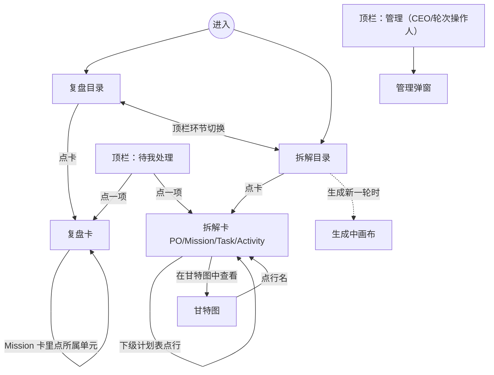
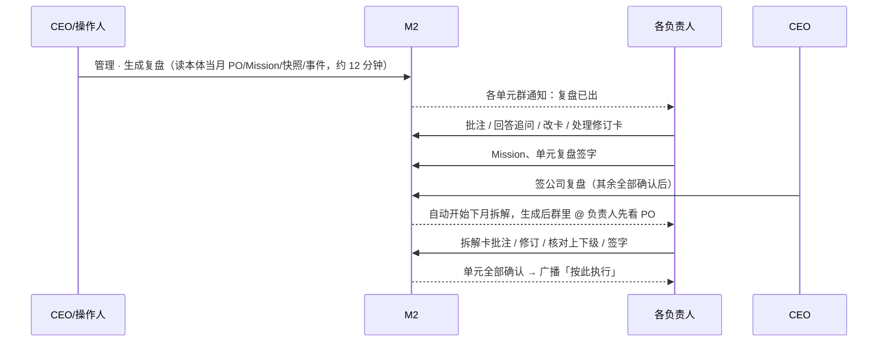

# M2 页面结构与功能

给天枢重做界面用，配合现场演示一起看。内容按 2026-10-23 线上版本（apps/m2）核对；接口字段说明 10/31 前另给。

## 1. 整体布局

```mermaid
flowchart LR
  subgraph 页面
    direction LR
    subgraph 左[「左：材料（画布）」]
      direction TB
      H[「顶栏：← 返回 · 标题/层级路径 · 待我处理 N · 管理 · 环节切换（X月复盘 / Y月拆解）· 文档/甘特图」]
      C[「主体：复盘目录 / 复盘卡 / 拆解目录 / 拆解卡 / 甘特图 / 生成中」]
      H --- C
    end
    subgraph 右[「右：沟通」]
      direction TB
      T[「标签：我的 Agent ｜ 单元群聊（进入单元后才有）｜ 纪要」]
      M[「消息流：消息 · 修订卡 · 通知 · 批注」]
      I[「输入框：@ · 回复 · 附件 · 语音」]
      T --- M --- I
    end
  end
  左 <--> 右
```

- 进入方式：从天枢右上角按钮进来，按登录账号直接进入自己的视角，不再选成员。
- 两个环节：**复盘**（月底）和**拆解**（月初）。同一套布局，顶栏切换。复盘全部确认、CEO 确认公司复盘、下月拆解生成好之前，"拆解"不能点。
- 弹窗：管理、新一轮拆解详情、批注浮层、修订动画。
- 窄屏（≤760px）左右上下叠放。

## 2. 页面地图



## 3. 各屏内容与操作

### 3.1 复盘目录
- 顶部：本体缺材料、没有复盘的单元名单。
- 列表只列和我有关的：CEO 看公司复盘 + 全部单元复盘；领域负责人看本单元；Mission 负责人看自己的 Mission + 所属单元。"待你确认"排前面。
- 每张摘要卡：标签（单元 / 单元简称·Mission N / 公司复盘）· 负责人 · 判定（达成 / 部分达成 / 未达成）· 状态（待你确认 / 待某人确认 / 还有 N 份未确认）· 批注数 · 标题 · 判定理由。点开进卡。

### 3.2 复盘卡
| 区域 | 内容 | 操作 |
|---|---|---|
| 卡头 | 标签、负责人、版本、判定、状态 | 负责人：✎ 编辑 |
| 判定 | 判定 + 理由；判定改过时显示"由 A 改为 B · 谁 · vN" | 批注 |
| 目标对照 | 每条目标 + 达成情况 | 整段或单条批注 |
| 原因 | 每条原因，可带"追问" | 负责人回答追问；其他人看到"待负责人回答" |
| 下月输入 | 每条带类型：欠账 / 待决策 / 继续验证 / 停止 / 约束 | 整段或单条批注 |
| 长期目标审视 | 建议维持 / 修改 / 重开 + 理由（公司卡） | 批注 |
| 单元卡下方 | 本单元 Mission 复盘列表 | 点开 |
| 底部 | 共同确认（签字） | 本人签 |

- 编辑：负责人直接改字段，保存为新版本，签字清零。**改判定例外**：不直接生效，变成一张修订卡，交另一位签字人决定。

### 3.3 拆解目录
- 顶部：轮次状态条（当前第 N 轮 / 生成中 / 已生成待载入 / 失败可续跑），CEO 和轮次操作人可"生成新一轮 / 载入 / 续跑"。
- 列表：成员看自己负责的 PO 和 Mission；CEO 看全部。摘要卡：标签 · 档位 P0/P1/P2 · 负责人 · 下级数 · 批注数 · 状态 · 标题 · 成果。没生成的卡写明原因，可在群里 @Nexus 补写。

### 3.4 拆解卡（PO / Mission / Task / Activity）
| 区域 | 内容 | 操作 |
|---|---|---|
| 层级路径 | 公司 › PO › Mission › Task | 每级可点 |
| 卡头 | 标签、档位、负责人、时间、版本、状态 | ✨ 请 Agent 审阅（所有人）；✎ 编辑（负责人） |
| 提示条 | 上级已改到 vN / 下级有调整 / 本轮没生成 | 负责人：核对完，不用改 |
| 字段 | 成果、成功标准、里程碑（时间轴）、逻辑（节点线）等；PO 另有取舍/依赖、本月暂缓；次要字段折叠在"更多信息" | 每个字段、每一条可批注 |
| 修订记录 | 每版谁改了什么（前/后） | 只看 |
| 下级计划表 | PO→Mission Plan；Mission→Task Plan；Task→Activity Plan。列：一句话成果、负责人、投入、按周时间条 | 点行打开；行批注；在甘特图中查看 |
| Activity | Task 下没有 Activity 时 | 生成 Activity Plan（Task/Mission/领域负责人、CEO），约 1–3 分钟 |
| 底部 | 共同确认（签字）；有未处理意见时先列出来，按钮变"仍然确认" | 本人签 |

### 3.5 甘特图
- 行：PO › Mission › Task，可折叠；列：周；红线是今天。
- 每行：已确认 ✓、"外 N"（依赖别的 Mission/领域的交付）、负责人；同一 Mission 内的前后依赖画箭头；Nexus 刚改过的行高亮。
- 开关："全部 / 只看我负责"、"收起 / 全部展开"；名称列可拖宽。点行名回到文档看卡。

### 3.6 生成中
- 拆解生成时整页换成生成页：进度（阶段、预估百分比、已等待时间）+ 骨架卡；复盘仍可切过去看。右侧只有私人 Agent，不能输入。

### 3.7 管理（只有 CEO 和轮次操作人）
| 区 | 内容 | 操作 |
|---|---|---|
| 复盘 | 当前标签、资料截至、共 N 份 / 已确认 M、没生成的单份（这次不上）、跳过的单元、本体读取时间；生成中显示进度 | 生成 / 重新生成复盘（二次确认：现有复盘和讨论归档，大家重新确认）；失败时列出原因，可"用上次的资料续跑" |
| 拆解 | 轮次状态、来源与版本（本体、资料、技能、模型）、本轮检查（数据、分解、人员负荷） | 重开、续跑、载入新一轮 |

## 4. 右侧沟通区

- **我的 Agent**：一对一，看得到我正在看的卡。回答可"带到规划群修改后发送"。
- **单元群聊**：一个单元一个群（公司复盘也有自己的群），成员 = CEO + 领域负责人 + 本单元卡的负责人 + Nexus。打开某单元的卡会自动切到它的群。
- **纪要**：已共识 / 正在讨论 / 待讨论，只读。
- **消息类型**：普通消息（Markdown、@ 高亮）、通知（@ 我时带"去确认 / 去核对"）、文档批注（带"卡 · 字段 · 第 N 条「引文」"，点了跳到位置）、修订卡、@所有人广播。每条可"回复"。
- **红点**：红色 = 本群待我处理的修订卡 + @我；灰色 = 未读。双击红点依次跳到每一项。
- **输入框**：回车发送；@ 候选是 Nexus + 群成员；回复某条；附件（txt/md/csv/json，≤24KB）；语音转文字。
- **Nexus 在群里怎么动**：先听，不一定说话；被 @、被回复、批注里提问时一定回应；能改就直接出修订卡（这时不再另配文字）；模型拒答时说明原因。

## 5. 批注 → 修订 → 确认

```mermaid
flowchart TD
  C[成员批注某字段/某一条] --> S[同时出现在单元群聊]
  S --> N{Nexus 判断}
  N -->|只是讨论| R[回复或不说话]
  N -->|要改| P[修订卡：原来 → 改成 · 依据]
  P --> O{依据是不是负责人本人在这张卡上的批注}
  O -->|是，且不改判定| AUTO[Nexus 直接改，升版本，群里通知可在修订记录查看]
  O -->|否| D{负责人}
  D -->|确认修改| V[升版本]
  D -->|不采用 + 理由| RJ[理由发到群里，Nexus 接着回应]
  OWN[负责人直接编辑] --> V
  V --> Z[签字清零，@ 签字人重新确认]
  V --> UP[上级卡：标「下级有调整」，@ 上级负责人]
  V --> DOWN[下级卡：标「上级已调整」，Nexus 对照后可能出对齐修订卡]
```

- 改判定（不管是人还是 Nexus 提的）一律走修订卡，由另一位签字人决定，不会自动生效。
- 修订卡被挡的情况：卡已过期或已处理、版本对不上、提出后群里有人新表示反对。
- 在群里回复修订卡"确认 / 同意 / 好 / 可以"也算接受。
- 接受时画布滚到对应字段，播放"正在修改 → 已更新 · vN"。

## 6. 签字

| 卡 | 签字人 |
|---|---|
| 公司复盘 | CEO |
| 单元复盘 / 单元 PO | CEO + 领域负责人 |
| Mission 复盘 / Mission | 领域负责人 + Mission 负责人 |
| Task / Activity | 不签，负责人自主修订 |

- 只能签当前版本；有上级调整未核对时不能签。全部签齐 → 群里通知"已达成共识"；整个单元签齐 → 广播。
- 公司复盘要等其余复盘全部确认后，CEO 才能签。

## 7. 待我处理

顶栏按钮，点开是列表，点一项直接到要处理的地方。

| 事项 | 去哪 |
|---|---|
| 修订卡待我确认 | 卡 + 群里那张修订卡 |
| 等我签字 | 卡底部的确认区 |
| 上级已调整 / 下级有调整，待核对 | 卡底部的确认区 |
| 有人反对，待我回应 | 群里那条消息 |
| 复盘追问待我回答 | 复盘卡的"原因" |
| 有人 @ 我 | 那个单元的群 |
| 我的卡有新批注 | 那张卡 |

## 8. 角色

| | 看什么 | 能做什么 |
|---|---|---|
| 成员 | 自己参与的单元和卡 | 批注、群聊、私人 Agent、请 Agent 审阅 |
| 卡负责人（Mission/Task） | 同上 | + 改自己的卡、处理修订卡、签 Mission 位、回答追问、生成 Activity |
| 领域负责人 | 本单元全部 | + 改本单元 PO、签本单元的位、给下级换负责人 |
| CEO | 全部 | + 签 CEO 位、改公司复盘、给 PO 换负责人、看审核结果、管理 |
| 轮次操作人（现为陈溪南） | 同成员 | + 管理：生成复盘、开始/续跑/载入拆解 |

## 9. 主流程



## 10. 接口（字段说明 10/31 前另给）

前端统一加 `/m2` 前缀。

| 接口 | 用途 | 刷新 |
|---|---|---|
| GET /api/data | 单元树、轮次、复盘摘要、模型/技能、本人身份 | 进入时；生成完成后 |
| GET /api/collaboration | 卡片当前版本、批注、各群和私聊消息、修订卡、纪要、Nexus 状态、待我处理所需数据 | 每 1.5 秒，带 ETag |
| POST /api/actions | 所有写操作：message、comment、deleteComment、revise、confirm、acknowledgeImpact、acceptProposal、rejectProposal、privateMessage | — |
| POST /api/agent | 私人 Agent，流式返回 | — |
| GET/POST /api/reviews | 复盘生成状态 / 开始、重新生成、续跑 | 生成中每 3 秒 |
| GET/POST /api/rounds、/api/rounds/activate | 拆解生成状态 / 开始、续跑、载入 | 生成中 1.5 秒，否则 10 秒 |
| GET/POST /api/activities | Activity 生成 | 生成中每 3 秒 |

## 11. 重做时要注意

- 现有界面里有、但很少用或没有入口的：手动让 Nexus 整理、暂停 Nexus、修订后的"改回"（只能再改一次）、复盘卡的修订记录（只有判定改动那一行）。重做时可以决定补不补。
- "待我处理"现在只在拆解目录和复盘页出现，进到拆解卡或甘特图里就看不到了。
- 哪些显示规则在共用文件里：判定/档位/状态文字（review-display.mjs）、Mission/Task 叫法（plan-labels.mjs）、阅读视图（reader-view.mjs）、复盘页给谁看什么（review-handoff.mjs、shared-projection.mjs）。重做时直接引用或照着实现，不要另写一套。
